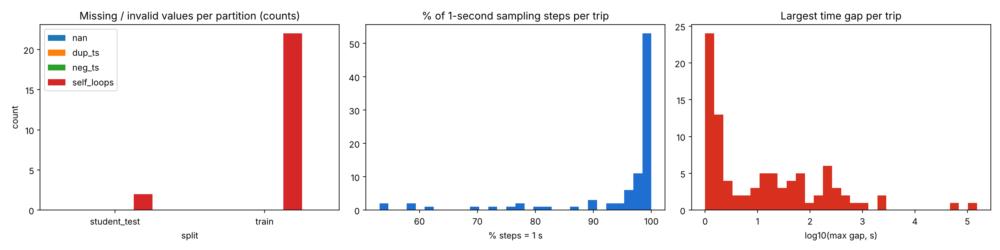
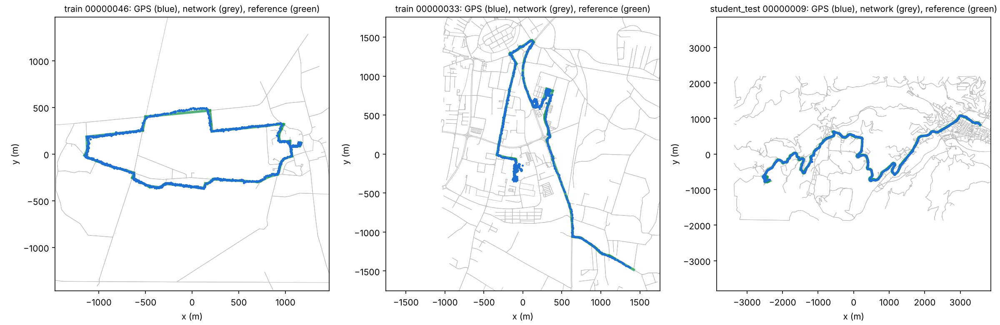
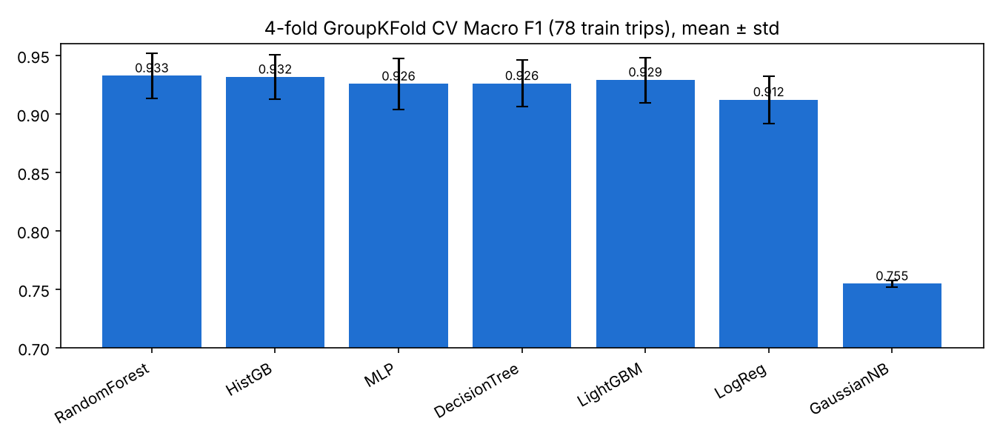
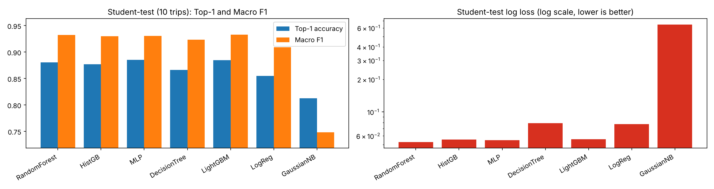
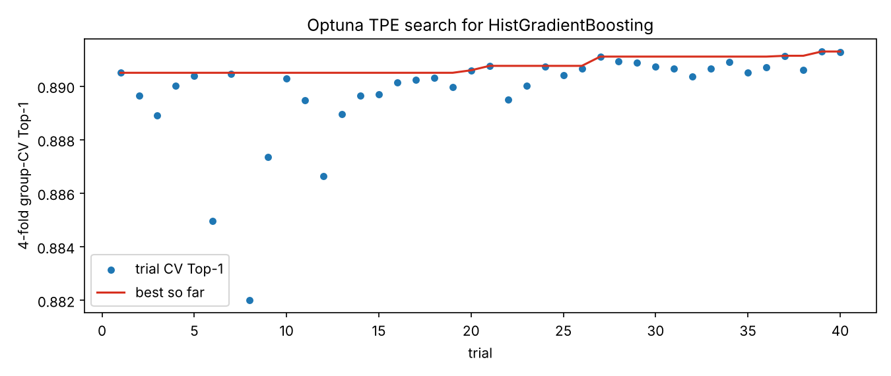
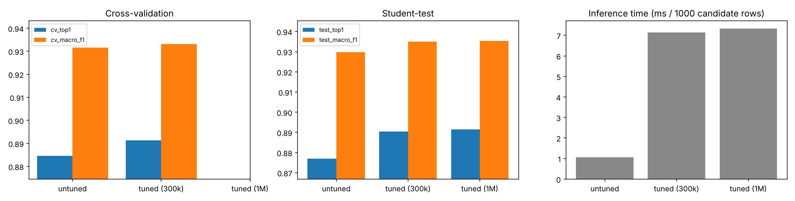
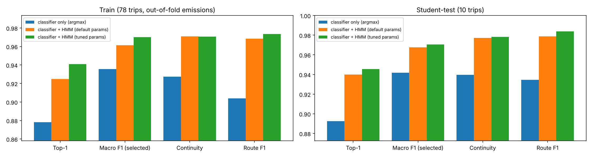
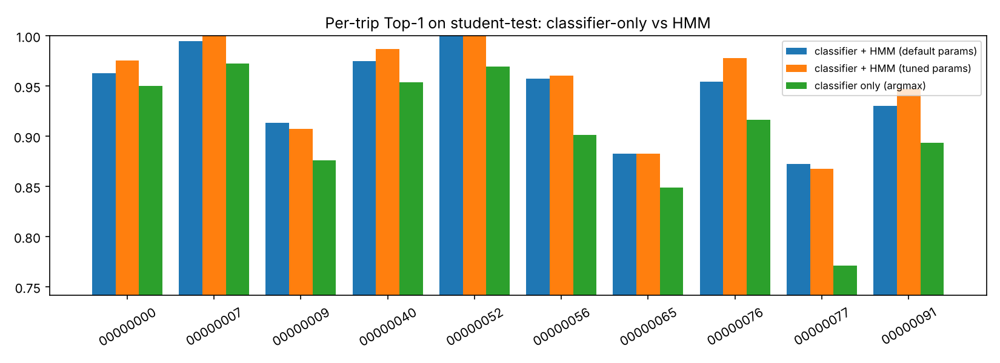
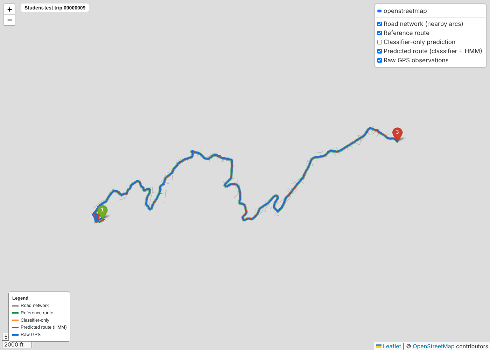
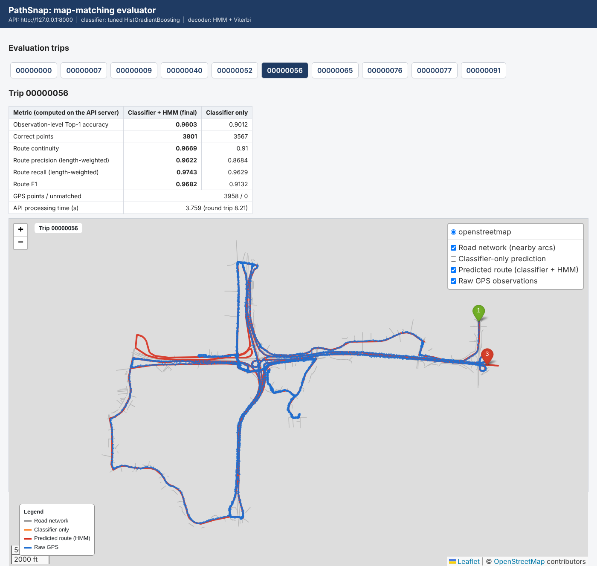

# PathSnap: technical report (DRAFT)

> **Status: draft generated with AI assistance (Claude).** Every number below is copied from a file in `data/` or `models/`
> and can be regenerated with the scripts listed in the README. Before submitting, the team must:
> (1) rewrite the explanations in its own words and check that each member can explain them in the viva;
> (2) add the per-model answers marked **TODO**;
> (3) replace the sandbox screenshots in section 7 with screenshots of the real two-laptop run (UI and the API console on Laptop 1);
> (4) export to one PDF.

## 1. Problem and approach

PathSnap matches noisy 1 Hz GPS observations to a trip-specific road network. Every trip has its own network and its own local arc ids, so we do not predict "which arc id" directly. Instead the problem is framed as **candidate scoring**:

1. Each GPS point gets up to 15 candidate arcs within 150 m (point-to-segment distance in a local equirectangular projection, in metres).
2. A binary classifier gives P(candidate = reference arc) for each candidate.
3. An HMM over the candidates is decoded with Viterbi, which gives one connected route.

## 2. Dataset understanding and EDA

Partitions used: **train (80 trips)** and **student_test (10 trips)**. The evaluator trips were not used in any analysis.

| Item | Value | Source |
|---|---|---|
| GPS points | train 208,417 (80 trips, 361 to 19,313 per trip); student-test 19,160 (10 trips) | `data/dataset_inventory.csv` |
| Missing (NaN) values / duplicate timestamps / negative time steps | 0 / 0 / 0 | `src/data_processing.py` |
| Share of 1 s steps | 96.7 % of all steps; 23 trips have a gap > 60 s (max 153,064 s, with only a 3.3 m jump) | inventory, `trip_stats.csv` |
| Network size | 299 to 155,003 nodes; 649 to 307,392 arcs | inventory |
| Connectivity | 0 isolated nodes; every reference route lies in one weakly connected component; node and arc ids are always valid | `data/network_connectivity.csv` |
| Twin arcs | median 95 % of arcs have a reverse twin; 1,903 duplicate arcs in total | `trip_stats.csv` |
| Reference route chain | not fully connected in 11 trips (minimum continuity 0.981) | `trip_stats.csv` |
| Speed anomalies | 42 trips have steps > 50 m/s (most in trips 32, 1, 13) | `trip_stats.csv` |
| Suspect reference | trips 33 and 54: median GPS-to-reference distance 122 m and 139 m → excluded from training and CV | `candidate_build_summary.csv` |

**Preprocessing.** Each trip is projected to metres around its mean lon/lat. Per-point labels come from a monotone dynamic-programming alignment of the GPS points to the ordered route (`align()` in `src/pathsnap_core.py`). This is an assumption: the `.route` file lists arcs, not one arc per point. Arcs with the same (from, to) pair count as the same label.

**Features (19).** The features fall into four groups:
- **Distance:** `d`, `rank`, `d_rel`, `d_prev`, `d_next`, `side_d`.
- **Position on the arc:** `t`, `dend`, `L`.
- **Heading agreement:** `cos_h`, from a ±2-point GPS heading. This separates twin arcs, which have identical geometry.
- **Topology:** `twin`, `indeg_u`, `outdeg_v`, `n_cand`.
- **GPS context:** `speed`, `dt_prev`, `step_prev`, `turn_cos`, `hvalid`.

On student-test, the candidate miss rate is 0.09 %. The simple baselines reach these Top-1 values: nearest arc 0.538, nearest arc with a heading penalty 0.850.

Figures: `figures/eda_missing_and_sampling.png`, `figures/eda_trip_sizes.png`, `figures/eda_trajectories_network.png`. Folium EDA maps: `eda/eda_map_train_00000046.html` and `eda/eda_map_33.html`.

## 3. Model experimentation and comparison

Protocol:
- Seed 42.
- 4-fold GroupKFold by trip on the 78 non-suspect train trips.
- Each fit uses a 300k-row sample of whole GPS points.
- CV Top-1 is averaged over validation trips. Student-test Top-1 is pooled over points.
- Macro F1 is on candidate rows at threshold 0.5.

Source: `data/model_comparison.csv`, `data/cv_fold_scores.csv`.

| Model | Family | Key configuration | CV Macro F1 | CV Top-1 | Student-test Top-1 | Route continuity (test, argmax) | Student-test Macro F1 | Log loss (test) | Train Macro F1 | Fit s | Inference ms / 1000 rows |
|---|---|---|---|---|---|---|---|---|---|---|---|
| RandomForest | Ensemble (bagging) | {n_estimators: 100, max_depth: 14, min_samples_leaf: 5} | 0.9327 ± 0.0194 | 0.8848 | 0.8805 | 0.9288 | 0.9321 | 0.0525 | 0.9568 | 10.9 | 1.37 |
| HistGB | Boosting | {max_iter: 200, learning_rate: 0.1, max_leaf_nodes: 31} | 0.9316 ± 0.0192 | 0.8845 | 0.8769 | 0.9260 | 0.9298 | 0.0557 | 0.9454 | 1.3 | 1.63 |
| MLP | Neural net | {hidden: [64, 32], max_iter: 30} | 0.9257 ± 0.0216 | 0.8798 | 0.8852 | 0.9359 | 0.9304 | 0.0548 | 0.9421 | 17.6 | 0.46 |
| DecisionTree | Tree | {max_depth: 12, min_samples_leaf: 20} | 0.9261 ± 0.0200 | 0.8794 | 0.8664 | 0.9231 | 0.9236 | 0.0788 | 0.9468 | 4.9 | 0.22 |
| LightGBM | Boosting | {n_estimators: 300, learning_rate: 0.1, num_leaves: 31} | 0.9291 ± 0.0193 | 0.8762 | 0.8849 | 0.9255 | 0.9333 | 0.0559 | 0.9522 | 1.5 | 1.40 |
| LogReg | Linear | {C: 1.0} | 0.9122 ± 0.0201 | 0.8678 | 0.8546 | 0.9208 | 0.9092 | 0.0774 | 0.9140 | 0.7 | 0.30 |
| GaussianNB | Probabilistic | {var_smoothing: 1e-09} | 0.7548 ± 0.0030 | 0.8378 | 0.8127 | 0.9127 | 0.7485 | 0.6457 | 0.7569 | 0.1 | 0.49 |

**Primary metric.** The primary metric is CV observation-level Top-1. It is exactly the decision the system makes for each point, and it is measured on unseen trips. Log loss is the secondary metric, because the HMM consumes the probabilities.

**Selection.** HistGB and RandomForest tie on CV Top-1 (0.8845 vs 0.8848; per-fold differences in `cv_fold_scores.csv`). HistGB fits about 8x faster (1.3 s vs 10.9 s) and has a smaller train/CV gap (train F1 0.945 vs 0.957), so we chose HistGB for tuning. Differences below about 1 point on 10 test trips are within noise.

**Overfitting check.** We compare train Macro F1 with CV Macro F1 for each model. GaussianNB underfits (0.757 / 0.755, with poorly calibrated probabilities: log loss 0.646). Trees and boosting show small gaps of 1 to 2.5 points.

Figures: `figures/models_cv_macro_f1.png`, `figures/models_cv_top1_folds.png`, `figures/models_student_test.png`, `figures/confusion_tuned_histgb.png`. MLP is the only model with an epoch history, so it is the only one with a training curve (`figures/mlp_training_curve.png`).

### 3.2 Per-model questions

**TODO (team):** for each of the 7 models, answer A1-2 (why suitable, strengths and limitations), B5-6 (hyperparameters and initial values: see the table; loss: log loss for LogReg, HistGB, LightGBM and MLP; Gini impurity for DecisionTree and RandomForest; Gaussian likelihood for NB) and C7-9 (results from the table; over- or underfitting from train vs CV F1 and from `cv_fold_scores.csv`). Connect each answer to the numbers above.

## 4. Bayesian hyperparameter optimisation (HistGB)

- **Sampler and objective:** Optuna TPE (seed 42, 10 random start-up trials). The objective is mean 4-fold group-CV Top-1, with the same folds and samples as the comparison.
- **Trials:** 41 trials (1 failed), 1,696 s in total.
- **Search space:**
  - learning_rate: log 0.02 to 0.3
  - max_iter: 100 to 500, step 50
  - max_leaf_nodes: log-int 8 to 127
  - min_samples_leaf: log-int 10 to 300
  - l2_regularization: log 1e-3 to 10
  - max_bins: {63, 127, 255}
- **Best configuration:** learning_rate 0.0950, max_iter 450, max_leaf_nodes 39, min_samples_leaf 210, l2_regularization 4.40, max_bins 255.

Sources: `data/optuna_histgb_trials.csv`, `data/optuna_histgb_best.json`, `data/tuned_vs_untuned.csv`.

| Model | CV Top-1 | CV Macro F1 | CV log loss | Test Top-1 | Test Macro F1 | Test log loss | Fit s | Inference ms / 1000 rows |
|---|---|---|---|---|---|---|---|---|
| HistGB untuned (300k) | 0.8845 | 0.9316 | 0.0577 | 0.8769 | 0.9298 | 0.0557 | 0.9 | 1.06 |
| HistGB tuned (300k) | 0.8913 | 0.9332 | 0.0537 | 0.8903 | 0.9350 | 0.0500 | 4.9 | 7.14 |
| HistGB tuned (1M rows) | n/a (no CV run at 1M rows) | n/a | n/a | 0.8914 | 0.9353 | 0.0495 | 17.5 | 7.34 |

The tuned model is better on every quality metric (+0.7 pts CV Top-1, +1.3 pts test Top-1, lower log loss). Its cost is about 5x slower inference, which is still about 7 µs per candidate row.

The **deployed** model (`models/histgb_tuned.joblib`) is the 1M-row configuration, refitted by `src/hmm_experiment.py`. In this environment (scikit-learn 1.9.1) it reached test log loss 0.0493 and Macro F1 0.9356 (`data/final_model_metrics.json`), with argmax Top-1 0.8926 (`data/hmm_vs_classifier.csv`). These are slightly different from the table above because of library-version differences.

## 5. HMM and Viterbi route reconstruction (`src/hmm.py`)

1. **Hidden states.** The states for GPS point *i* are its candidate rows. Each state *is* one arc, so the candidate-to-segment correspondence is kept.
2. **Emissions.** w_emis · log p̂, where p̂ is the classifier probability renormalised over the point's candidates.
3. **Transitions** (Newson-Krumm style):
   - Route distance r: on the same arc, r = |movement along the arc|. Otherwise, r = the rest of arc a + the Dijkstra shortest path from a.to to b.from + the start of arc b (directed network, limit 2·g + 300 m, capped at 4 km).
   - log T = −|r − g| / β − uturn_pen·[b is the reverse twin of a] − back_pen·[moves backwards more than 10 m on the same arc].
   - g is the straight-line **spatial** distance between the GPS points, not elapsed time. Time gaps do not imply distance gaps.
4. **Missing candidates and gaps.** Points without candidates have no state. They are skipped, reported as unmatched (−1) and counted as wrong. If the gap between consecutive matched points is larger than gap_m, the chain is cut (uniform transition) and decoding restarts from the emissions.
5. **Disconnected segments.** Unreachable pairs get a finite penalty −disc_pen, so Viterbi can always continue. For drawing, consecutive decoded arcs that are not adjacent are joined with the shortest path (`fill_route`).
6. **Recurrence.** δᵢ(b) = eᵢ(b) + maxₐ[δᵢ₋₁(a) + log T(a, b)], with back-pointers and a backtrack at the end.

**Decoder tuning.** Emissions on the train trips are out-of-fold predictions (4-fold GroupKFold, tuned HistGB), so they resemble predictions on unseen trips. We ran Optuna TPE for 30 trials, with trial 0 set to the hand-picked defaults. The objective is pooled train Top-1. The student-test and evaluator trips were not used.

Best parameters: w_emis 0.374, β 2.94, disc_pen 38.7, uturn_pen 7.81, back_pen 0.60, gap_m 300 (`models/hmm_config.json`, `data/hmm_decoder_trials.csv`). β and disc_pen ended near the edges of the search range. A wider search is possible future work.

| Split | Method | Top-1 (pooled) | Macro F1 (selected candidate) | Route continuity | Route precision | Route recall | Route F1 | Trips with Top-1 ≥ 0.95 |
|---|---|---|---|---|---|---|---|---|
| Train OOF (78 trips) | classifier only | 0.8782 | 0.9357 | 0.9275 | 0.8615 | 0.9628 | 0.9039 | 22 |
| Train OOF | + HMM (defaults) | 0.9249 | 0.9612 | 0.9711 | 0.9725 | 0.9654 | 0.9683 | 43 |
| Train OOF | + HMM (tuned) | **0.9410** | 0.9701 | 0.9705 | 0.9819 | 0.9661 | 0.9735 | 48 |
| Student-test (10 trips) | classifier only | 0.8926 | 0.9418 | 0.9396 | 0.8972 | 0.9777 | 0.9346 | 4 |
| Student-test | + HMM (defaults) | 0.9398 | 0.9675 | 0.9771 | 0.9794 | 0.9780 | 0.9787 | 6 |
| Student-test | + HMM (tuned) | **0.9456** | **0.9706** | **0.9781** | 0.9865 | 0.9812 | **0.9838** | 6 |

Source: `data/hmm_vs_classifier.csv`; per trip in `data/hmm_per_trip.csv`.

Route precision/recall are length-weighted over the set of traversed segments. The reference-label continuity ceiling on student-test is 0.9851.

**Where the HMM did not help.**
- On student-test trip 00000009, the tuned decoder (0.9075) is below the default decoder (0.9133), though still above classifier-only (0.8761).
- On trip 00000077, tuned scores 0.8673 vs default 0.8727.
- On train OOF, the HMM lowered Top-1 on 3 of 78 trips (00000045 −2.8 pts, 00000066 −1.4 pts, 00000005 −0.2 pts).
- The HMM mainly removes isolated wrong picks (twin arcs, parallel roads). It cannot fix stretches where the classifier is confidently wrong for many consecutive points.

## 6. Folium geographical visualisation

`src/route_map.py` builds every map. The layers are: road network near the trip (grey), raw GPS (blue dots), reference route (green, development trips only), classifier-only route (orange dashed, toggle) and HMM route (red). Each map has start and end markers, a legend, a layer control and fit-to-bounds zoom.

Maps for all 10 student-test trips: `maps/student_test_*.html` (from `src/make_maps.py`).

*(Sandbox render without basemap tiles; the screenshot for the PDF should be retaken on a laptop with internet.)*

## 7. API, UI and deployment

- **API** (`api/main.py`, FastAPI, Laptop 1):
  - Endpoints: `/health`, `/trips`, `POST /predict {trip_id}`.
  - Pipeline: features → classifier → HMM.
  - Scoring happens on the server: `.route` is read only after the prediction, and only metrics are returned.
  - Every request is logged to the console and to `api/logs/api.log`.
- **UI** (`ui/app.py`, Laptop 2):
  - Lists the trips from the API and sends only the trip id.
  - Shows the metrics (HMM vs classifier-only) and the Folium map.
- **Latency:** about 0.2 to 3.8 s per trip on the development trips.

**TODO (team):** add screenshots of the UI on Laptop 2 and of the API console on Laptop 1 during the real run.

*(Development dry run: API pointed at a student-test trip, sandbox without basemap tiles.)*

## 8. Academic integrity and AI disclosure

AI assistance (Claude) was used for parts of the code (HMM decoder, API, UI, plotting), for refactoring, and to draft this report. All experiments were run, and all numbers come from the committed scripts and outputs. The evaluator-test data was not used for training, features, model choice or tuning. It was used once at the end, after all choices were frozen, to check that the API handles all 10 trips.
